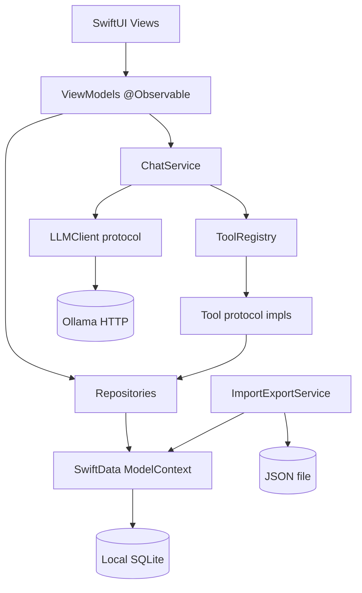
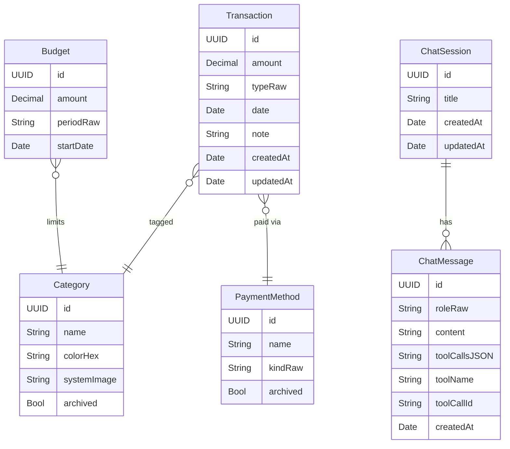
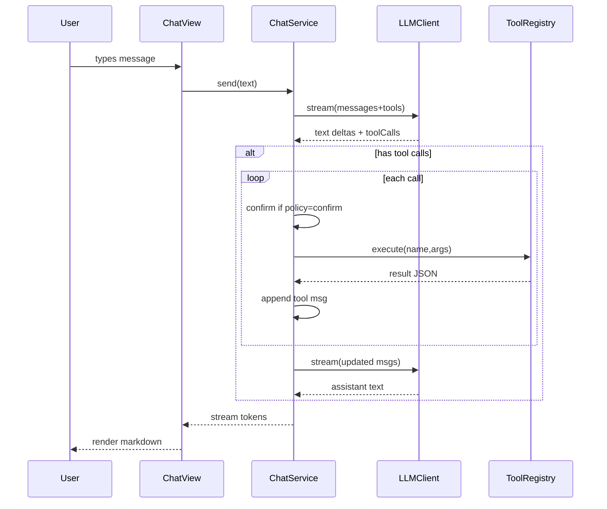
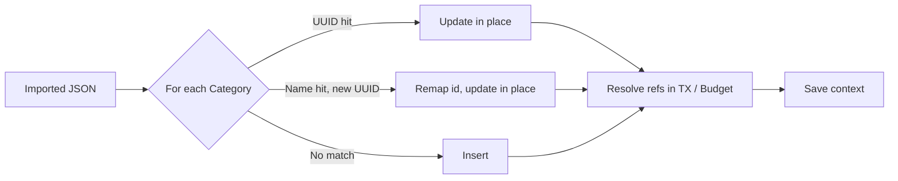

# Spending Tracker — Architecture, Use Cases & Maintenance Guide

A personal-finance macOS app with JSON import/export and a local-LLM chatbot.

---

## 1. Goals

- Track income and expenses in INR with categories, payment methods, notes.
- Local-only storage (SwiftData). No iCloud — personal Apple Developer accounts lack the iCloud capability.
- Manual backup/restore as a JSON file (import preserves the **union** of existing and imported data; no duplicates).
- Configurable categories, payment methods, monthly budgets.
- AI chatbot powered by a local LLM (Ollama) that can read and mutate data through tool calls.
- Strictly extensible: add new LLM providers, tools, dashboard widgets, repositories without touching unrelated code.

## 2. High-level component diagram



## 3. Folder structure

```
Spending Tracker/
  App/                      Composition root (AppContainer) + @main entry
  Models/                   SwiftData @Model classes + domain enums
  Persistence/              ModelContainer factory, default-data seeder, ImportExportService + BackupTypes
  Repositories/             Protocols + SwiftData implementations
  Utils/                    CurrencyFormatter, DateRange, JSONValue, ColorHex
  Features/
    Dashboard/              Dashboard view + view model + widgets
    Transactions/           List, editor, row, view model
    Search/                 Search view + view model + filters
    Budgets/                Budgets screen + view model
    Chatbot/                Chat view, markdown renderer, confirm UI
    Settings/               AppSettings + tabbed settings UI
  Sidebar/                  RootView + SidebarRoute enum
  LLM/
    Client/                 LLMClient protocol, factory, OllamaClient
    Tools/                  Tool protocol, registry, tool impls
    Chat/                   ChatService, ChatTypes
  Spending_Tracker.entitlements
  Assets.xcassets/
Spending TrackerTests/
  RepositoryTests           In-memory SwiftData tests
  ToolTests                 Each tool's behavior
  ChatServiceTests          Tool-call loop with mock LLM
docs/ARCHITECTURE.md        This document
```

The Xcode project uses `PBXFileSystemSynchronizedRootGroup`, so any Swift file placed under `Spending Tracker/` is automatically part of the app target — no pbxproj edit needed when adding files.

## 4. Data model



Model conventions:
- All scalar properties have defaults (also makes JSON-import upserts safe).
- All relationships are optional with explicit inverses (`Category.transactions` ↔ `Transaction.category`, etc.).
- UUIDs are unique by generation; no `@Attribute(.unique)` is needed.

## 5. Layered architecture rules

| Layer | Responsibility | Knows about |
|-------|---------------|-------------|
| Views | Render, capture input | View models |
| View models (`@Observable`) | Hold state, orchestrate | Repositories, services |
| Repositories | Persistence access | SwiftData, models |
| Tools | Domain action exposed to LLM | Repositories |
| LLM client | Provider transport | HTTP, message format |
| ChatService | Orchestrate LLM ↔ tools | Client, registry, settings |

Forbidden:
- Views calling repositories directly.
- View models touching `ModelContext` directly.
- Tools using SwiftData APIs directly.
- LLM client knowing about app domain.

## 6. Composition root

`AppContainer` is constructed once by `@main` and wires every dependency. Anything that needs a singleton-ish lifetime lives there. View models receive their collaborators via initializer injection — no service locators, no globals.

## 7. Sidebar / navigation

`NavigationSplitView` with six destinations:

| Route | Screen |
|-------|--------|
| Dashboard | `DashboardView` |
| Transactions | `TransactionListView` |
| Search | `SearchView` |
| Budgets | `BudgetsView` |
| Chatbot | `ChatView` |
| Settings | `SettingsView` (Categories / Payment Methods / LLM) |

## 8. Dashboard widgets

All widgets conform to a uniform card style (`WidgetCard`) and are independent — adding a new one means writing a view and adding a cell in `DashboardView`'s grid.

- This-month summary (expense / income / net)
- Spending trend (last 30 days, Swift Charts bar chart)
- Top categories (% of expenses)
- Budget burn-down (per-category progress bars)
- Payment method breakdown (horizontal Swift Charts bar)
- Recent transactions (last 5, tappable to edit)
- Largest expense this month
- Compare vs last month (per-category delta %)

Quick-add via ⌘N in the dashboard's toolbar.

## 9. LLM architecture

### Components

- `LLMClient` protocol — transport-agnostic: `chat(messages, tools)` and `stream(messages, tools)`.
- `LLMClientFactory` — single entry point: `LLMClientFactory.make(config)`.
- `OllamaClient` — current implementation, hits `POST /api/chat` on the configured base URL.
- `Tool` protocol — `name`, `description`, `kind` (.read/.write/.delete), `parameters: JSONValue` (JSON Schema), `run(arguments:context:)`.
- `ToolRegistry` — holds all tools, hands their schemas to the LLM each turn, dispatches calls by name.
- `ChatService` — owns the loop:
  1. Send accumulated `messages` + tool schemas.
  2. Stream assistant deltas into `streamingAssistantText`.
  3. On finished response, if it contains tool calls, gate each by per-kind `ToolConfirmPolicy` (auto / confirm / disabled).
  4. Execute approved calls, append tool messages, loop.
  5. Stop on plain text response or after `maxToolIterations` (8).

### Sequence



### Tool catalog

| Tool | Kind | Purpose |
|------|------|---------|
| `add_transaction` | write | Insert new transaction |
| `update_transaction` | write | Patch fields by id |
| `delete_transaction` | delete | Remove by id |
| `list_transactions` | read | Filter by date / type / category / payment method |
| `search_transactions` | read | Free-text search across notes, categories, methods |
| `get_categories` | read | List categories |
| `get_payment_methods` | read | List payment methods |
| `create_category` | write | New category (color + icon optional) |
| `create_payment_method` | write | New payment method |
| `get_summary` | read | Totals + grouping (category / pm / type / day) over a period |
| `get_budget_status` | read | Current-month budget usage per category |

### Confirmation gate

Each `ToolKind` maps to a `ToolConfirmPolicy` in `AppSettings`:
- `read`: default `auto`
- `write`: default `confirm` (UI shows `ToolConfirmView` with full args before running)
- `delete`: default `confirm`

`disabled` makes the tool report an error back to the LLM without executing.

### Streaming + safety

- Streamed text appears live in the chat.
- The tool-call loop runs after each completion.
- Max 8 tool iterations per user message (loop guard).
- All tool results are JSON; tool errors are stringified into `{"error": ...}` so the model can recover.

### MCP-readiness

Tools expose `(name, description, JSON Schema parameters, async handler)`. That is exactly the shape MCP expects from a tool-providing server. Wrapping the registry behind an MCP transport (stdio or HTTP) is a future task that does not require changing tool code.

## 10. Settings

`AppSettings` is `@Observable` and reads/writes to `UserDefaults`:

| Key | Purpose |
|-----|---------|
| LLM provider, Ollama base URL, model, temperature | Routed into `LLMConfig` per call |
| Read / write / delete tool policies | Per-kind confirm gating |
| Persist chat history flag | Reserved for ChatRepository wiring |

## 11. Use cases (end-to-end)

### UC-1 — Add a transaction manually

1. From Dashboard or Transactions, press ⌘N.
2. `TransactionEditorView` opens, prefilled with defaults.
3. User enters amount, picks type/category/payment method, optional note.
4. Save → `TransactionsViewModel.addTransaction(tx)` → `SwiftDataTransactionRepository.add(tx)` → CloudKit replicates.

### UC-2 — Edit and delete

1. Click a row in `TransactionListView` (or the recent-tx widget on the dashboard).
2. Editor opens in edit mode → mutate fields → Save → `repo.update`.
3. Delete via toolbar `Delete` button or row context-menu → `repo.delete`.

### UC-3 — Search & filter

1. Sidebar → Search.
2. Type query (matches note/category/payment method). Add chips (categories, methods), date range, amount range, type.
3. Results live-update.

### UC-4 — Budget tracking

1. Sidebar → Budgets → "Add Budget".
2. Pick category, monthly limit.
3. Dashboard's `BudgetBurnDownWidget` and Budgets list now show usage. Color shifts: green → orange → red as % grows.

### UC-5 — Configure categories / payment methods

1. Sidebar → Settings → Categories tab.
2. Add new (name, color hex, SF Symbol), archive existing, delete.
3. Same flow for Payment Methods.

### UC-6 — Chat: "How much did I spend on food this month?"

1. Chatbot view → type the question → ⌘↩.
2. ChatService streams an assistant response that contains a tool call to `get_summary` with `{ "period": "this_month", "group_by": "category" }` (or `list_transactions` + `search_transactions`).
3. Read policy is `auto` → executed immediately, JSON appended as tool message.
4. Second LLM round produces the natural-language answer with the figure.
5. Markdown rendered in the bubble.

### UC-7 — Chat: "Add ₹150 expense for groceries today"

1. User asks.
2. Model emits `add_transaction` tool call.
3. Write policy `confirm` (default) → `ToolConfirmView` appears in the chat with the full arguments JSON.
4. User clicks Approve → `AddTransactionTool.run` inserts the transaction.
5. Tool result returned to LLM → assistant confirms in natural language.

### UC-8 — Backup and restore (replaces multi-device sync)

1. Settings → Backup → "Export to JSON…" — saves a single file containing categories, payment methods, transactions, budgets, and (optionally) chat history.
2. On another Mac (or after a reinstall): Settings → Backup → "Import from JSON…".
3. Choose **Merge** (default) or **Replace**.
   - **Merge** — `ImportExportService` walks every row in the file and performs an upsert:
     - Categories and payment methods are matched **first by UUID, then by normalized name**. If a local row with the same name but a different UUID exists, the imported UUID is remapped to the local row's UUID so referencing transactions and budgets stay consistent. No duplicate tag is ever created.
     - Transactions and budgets are matched by UUID only.
     - Budgets additionally dedupe by `(category, period)` — one monthly budget per category is the invariant.
     - Net effect: the union of local + imported data, by identity. Re-importing the same file is a no-op after the first run.
   - **Replace** — wipes local data first, then imports.



## 12. Concurrency model

- Default actor isolation is `MainActor` (`SWIFT_DEFAULT_ACTOR_ISOLATION = MainActor`).
- Repositories, view models, tools, ChatService all run on the main actor.
- `OllamaClient` is `final ... @unchecked Sendable` (its only stored state is immutable `URLSession` + `LLMConfig`); network I/O uses async `URLSession.bytes(for:)`.
- All `@Model` classes stay on the main context — sufficient for the app's scale.

## 13. Entitlements

`Spending Tracker/Spending_Tracker.entitlements`:

- `com.apple.security.app-sandbox` — required, app is sandboxed.
- `com.apple.security.network.client` — required so the app can hit Ollama at `http://localhost:11434`.
- `com.apple.security.files.user-selected.read-write` — required for Import/Export via `NSOpenPanel` / `NSSavePanel`.

No iCloud / CloudKit entitlements are present, because the app stores data locally only (personal Apple Developer accounts cannot ship iCloud-capable apps). The build setting `CODE_SIGN_ENTITLEMENTS = Spending Tracker/Spending_Tracker.entitlements` and `ENABLE_USER_SELECTED_FILES = readwrite` are set on both Debug and Release app target configs.

If Ollama runs on a remote machine (e.g. on the LAN), update Settings → LLM → Base URL. The network-client entitlement covers any outbound HTTP.

## 14. Testing

Tests use Swift Testing (`@Test`, `#expect`).

| Suite | Coverage |
|-------|----------|
| `RepositoryTests` | CRUD against in-memory SwiftData; filter predicates; chat session message ordering |
| `ToolTests` | Each tool's success path + a few negative cases (invalid amount, duplicate category) |
| `ChatServiceTests` | Tool-call loop with `MockLLMClient` providing scripted responses |
| `ImportExportTests` | Round-trip preserves data, merge is UNION, name-dedup remaps refs, replace wipes |

Run with ⌘U in Xcode, or:

```bash
xcodebuild test \
  -project "Spending Tracker.xcodeproj" \
  -scheme "Spending Tracker" \
  -destination 'platform=macOS'
```

## 15. Extensibility recipes

### Add a new LLM provider (e.g. OpenAI)

1. Add a case in `LLMProvider` enum (`Models/Enums.swift`).
2. Implement `OpenAIClient: LLMClient` translating to/from the OpenAI chat-completions schema.
3. Add a case to `LLMClientFactory.make` that returns the new client.
4. Expose any new config fields in `AppSettings` + `LLMSettingsView`.

No other code changes are required.

### Add a new tool

1. Create `<Name>Tool: Tool` in `LLM/Tools/`.
2. Define `name`, `description`, `kind`, `parameters` (use `JSONSchemaBuilder` helpers).
3. Implement `run(arguments:context:)`. Use `ToolArgs` helpers to extract typed args.
4. Register in `ToolRegistry.defaultRegistry()`.

The tool is automatically advertised to the LLM next turn.

### Add a new dashboard widget

1. Write a SwiftUI `struct ...Widget: View` that takes its data via init.
2. Add the data computation to `DashboardViewModel.load`.
3. Drop the widget into `DashboardView`'s `LazyVGrid`.

### Add a new model field

1. Edit the `@Model` class. Provide a default value — required for CloudKit.
2. Update repositories and any tool that touches that field.
3. SwiftData lightweight migration handles the schema change automatically.

For breaking schema changes (renamed fields, type changes), add a `VersionedSchema` and `SchemaMigrationPlan` per Apple's docs.

## 16. Maintenance guide

### Common operations

- **Reset local data**: delete the app's container directory, or run with `PersistenceController.makeContainer(inMemory: true)` during development.
- **Move data to another Mac / restore**: Settings → Backup → Export, then Import on the target machine. Merge mode is safe to re-run.
- **Switch Ollama models**: Settings → LLM → Model. Recommended models with tool support: `llama3.1`, `qwen2.5`, `firefunction-v2`.
- **Change INR formatting**: edit `CurrencyFormatter`. Locale is `en_IN`.

### Pitfalls and how they're handled

| Problem | Where it's handled |
|---------|--------------------|
| SwiftData `#Predicate` can't traverse all relations cleanly | `TransactionQuery` does category/PM/amount/text filtering in memory after a coarse predicate |
| Sandbox blocks Ollama HTTP | `com.apple.security.network.client` entitlement |
| Sandbox blocks user file pick | `com.apple.security.files.user-selected.read-write` + `ENABLE_USER_SELECTED_FILES = readwrite` |
| Re-importing creates duplicates | UUID-then-name dedup; budget unique by (category, period); merge is idempotent |
| LLM loops on tools | `maxToolIterations = 8` in ChatService |
| Tool errors crash the loop | Errors serialized to JSON and re-fed to the model |
| Markdown library overhead | Custom minimal markdown renderer with code blocks, headings, lists, blockquotes |

### When to refactor

- If a fourth LLM provider gets added, hoist Ollama-specific JSON helpers out of `OllamaClient` into a shared `LLMTransport`.
- If chat history persistence is enabled (currently a flag without wiring), inject `ChatRepository` into `ChatService` and call `append` on every message.
- If tool count grows past ~20, consider grouping registry exposure (e.g. allow restricting which tools an LLM session sees).

### Logging

Currently minimal. To add structured logs:

1. Import `OSLog` in `ChatService` and `OllamaClient`.
2. Create a `Logger(subsystem: "com.mahasvan.Spending-Tracker", category: ...)`.
3. Log at info/error around tool execution and HTTP boundaries.

## 17. Deferred (post-v1)

- Receipt attachments / OCR
- Recurring transactions
- Multi-currency
- Weekly / yearly budget periods
- CSV export (JSON already supported)
- MCP-server wrapper around the existing tool registry
- Additional LLM providers (OpenAI, Anthropic, llama.cpp)
- Snapshot-based UI tests for critical flows
- Chat history persistence wired to `SwiftDataChatRepository`
- Automatic periodic backup to a user-chosen folder

---

Last updated alongside v1 implementation.
